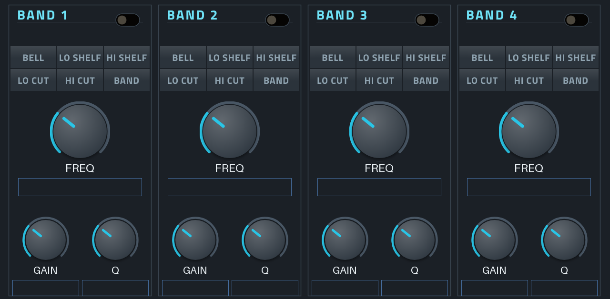
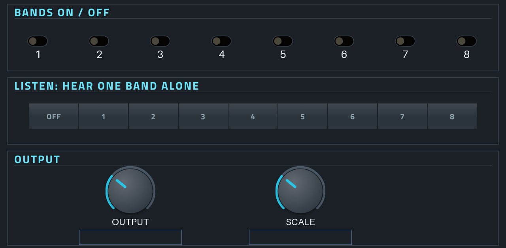

# Free EQ8 für Akai Force / MPC

Ein 8-Band-EQ als Insert-Effekt für die Force (und die anderen MPC-OS-Geräte), gebaut mit
[mpc-vst-plugins](https://github.com/sd88me/mpc-vst-plugins). Die Filter stammen aus
[FreeEQ8](https://github.com/GareBear99/FreeEQ8) (RBJ-Biquads, inkl. Shelf-Fix aus v2.3.1).

MPC-Skins können keine Kurven zeichnen. Statt einer EQ-Kurve gibt es deshalb große Werte
(„1.20 kHz", „+3.5 dB") und eine Bedienung über die Q-Links.



## Bedienung

**Seiten BANDS 1-4 und BANDS 5-8**, eine Spalte pro Band:

- Schalter oben rechts: Band an/aus (sanft eingeblendet, kein Knacken)
- Typ: BELL, LO SHELF, HI SHELF, LO CUT, HI CUT, BAND (Bandpass)
- FREQ: 20 Hz bis 20 kHz
- GAIN: −24 bis +24 dB (nur bei Bell und Shelves)
- Q: 0,1 bis 24 (Bandbreite; bei Cuts die Resonanz an der Kante, 0,71 = keine)
- Bei LO CUT / HI CUT erscheint statt GAIN die Flanke: 12, 24 oder 48 dB pro Oktave

**Q-Links** folgen den Spalten: Knopf 1/2 = Band 1 FREQ/GAIN, 3/4 = Band 2, 5/6 = Band 3, 7/8 = Band 4.
Auf der zweiten Q-Link-Bank liegt Q jeweils unter dem FREQ-Knopf des Bandes. Schalter und Typwahl liegen nicht
auf den Q-Links.

**Seite MASTER**



- Alle 8 Bänder auf einen Blick an/aus
- LISTEN: hört nur den Frequenzbereich eines Bandes (Bandpass an Frequenz und Q des Bandes). So findest du,
  wo zwei Spuren sich überlagern. Danach wieder auf OFF.
- OUTPUT: Ausgangspegel ±24 dB
- SCALE: skaliert alle Band-Gains gleichzeitig (0–200 %), zum Abschwächen oder Verstärken des ganzen EQs

**Presets** (PRESET-Menü der Force): Neutral, Kick Clean, Psy Bass, Lead Forward, Pad Make Room, Hi-Hats, Voice,
Master Gentle, Telephone, DJ Low Cut. Alles Startpunkte, nach Gehör anpassen.

MIDI-CC 20–35 bewegen die Q-Links der ersten Seite (CC 20 = Band 1 FREQ, CC 21 = Band 1 GAIN usw.), etwa vom Faderfox oder über CC Map.

## Bauen und installieren

1. Repo auf GitHub hochladen.
2. **Actions → „VST release (draft)" → Run workflow**, Version z. B. `1.0.0`.
3. Im Release-Entwurf liegt `Free-EQ8-1.0.0-mpc-armv7.zip` (Force und Gen1-MPCs) und eine aarch64-Version (Gen2).
4. Installieren wie bei den anderen Plugins:
   ```
   scp -r Free-EQ8-1.0.0 root@<force-ip>:/tmp/
   ssh root@<force-ip> sh /tmp/Free-EQ8-1.0.0/install.sh
   ```
   Der Installer stoppt MPC kurz (vorher Projekt speichern), sichert `MPC.settings` und startet MPC neu.
5. Auf einer Spur: Insert → Effekte → **Free EQ8**.

Lokal (mit Docker): `MPC_VST=/pfad/zu/mpc-vst-plugins vst/build.sh`.

## Entwicklung

- `src/eq8.c`: Engine (Bänder, Gleiten, Überblendungen, LISTEN, Ausgang)
- `src/biquad.h`: Filter aus FreeEQ8 (siehe `src/VENDORED.md`)
- `tools/make_params.py` erzeugt `vst/params.json` und `vst/presets.json`
- `tools/make_layout.py` erzeugt `vst/layout.conf` (Skin), `vst/skin.css` setzt die Schriftgrößen
- Parameter nur hinten anhängen: `vst/params.lock` prüft die Reihenfolge (Projekte speichern nach Index)

Offline geprüft: Host-Test von mpc-vst-plugins (ASan) bestanden; Frequenzgang gemessen (Bell +6 dB bei 1 kHz
= +6,00 dB, Low Cut 100 Hz/24 dB = −3 dB bei 100 Hz und −24 dB bei 50 Hz, 48 dB = −48 dB eine Oktave darunter);
Schalten von Band und Typ ohne Knackser. Auf der Force noch nicht getestet.

## Lizenz

GPL-3.0-or-later (wie FreeEQ8). Kein Bezug zu Ableton; „EQ8" bezeichnet nur die acht Bänder.
